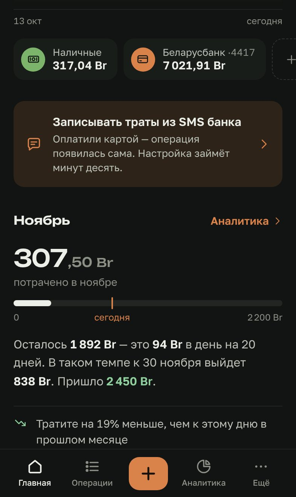
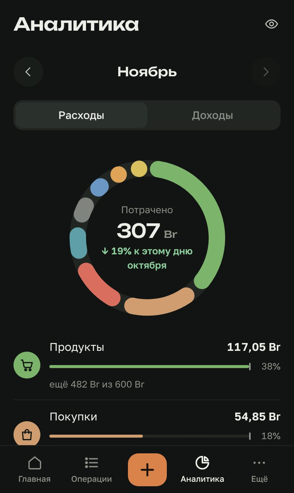
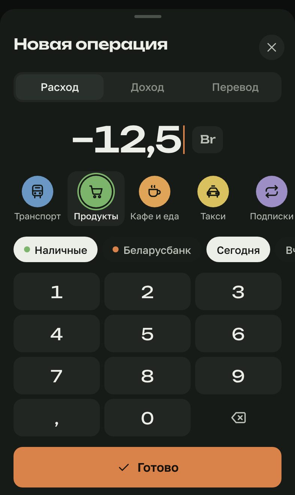
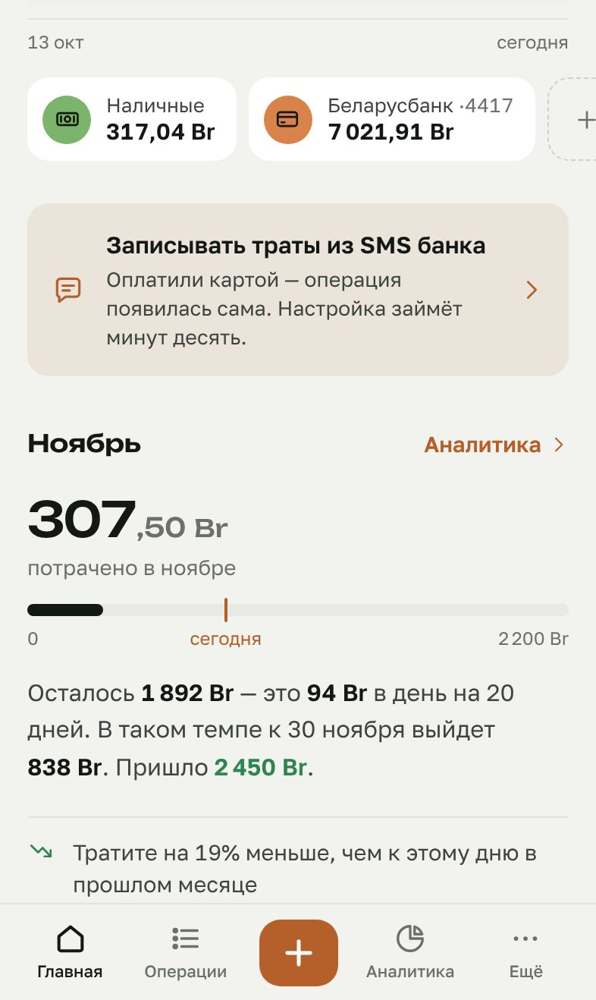

# Копейка

Учёт денег, который ведётся сам: оплатили картой — пришла SMS от банка — операция, категория и остаток карты появились в приложении.
Сделано под SMS Беларусбанка (отправитель `asb.by`), работает на iPhone как приложение с экрана «Домой».

**Открыть:** https://mihailmoskalenko08-eng.github.io/projectX/

<p>
  
  
  
  
</p>

## Что умеет

- **Траты из SMS.** Разбирает SMS банка: сумму, валюту, карту, дату, магазин, город, MCC-код и остаток.
  Оплата — расход, зачисление — доход, возврат уменьшает расходы категории, снятие наличных — перевод с карты в кошелёк, отказ — пропускается.
  Незнакомые типы операций попадают «на разбор», а не теряются. Одна и та же SMS не запишется дважды.
- **Категории сами.** По MCC-коду (4111 → транспорт, 5411 → продукты…) и по названию магазина.
  Поменяли категорию — приложение запомнит магазин и поправит его прошлые покупки.
- **Остаток карты из банка.** Берётся из `OSTATOK` в последней SMS; ручные операции после неё добавляются сверху.
- **Покупки в валюте** считаются в рублях по фактическому списанию (разница остатков), иначе — по курсу (курсы Нацбанка в один тап).
- **Месяц словами:** сколько потрачено, сколько осталось от бюджета, сколько можно тратить в день, прогноз до конца месяца.
- **Аналитика:** кольцо категорий, темп трат против прошлого месяца, траты по дням и дням недели, где тратите больше всего.
- **Регулярные платежи** (подписки, связь) находятся сами по истории, видно, что скоро спишется.
- Бюджеты на месяц и по категориям, месяц от зарплаты до зарплаты, свои категории, несколько счетов и валют.
- Ручной ввод в пару касаний, вставка SMS из буфера, скрытие сумм, тёмная и светлая тема.
- Резервная копия в файл, выгрузка в CSV для Excel/Numbers, демо-данные, чтобы посмотреть, как всё выглядит.
- Работает без интернета. Все данные — только на телефоне.

## Как это устроено

```
SMS от asb.by ──► «Команды» на iPhone ──► ваш сервер на Cloudflare ──► «Копейка»
                  (автоматизация           (почтовый ящик,             (забирает новые SMS
                   «Сообщение»)             бесплатно)                  при открытии и удаляет)
```

Ни одно приложение на iPhone не может само читать «Сообщения» — это умеют только «Команды».
Веб-приложение с экрана «Домой» нельзя открыть из «Команд» напрямую, поэтому между ними — маленький сервер-ящик.

## Настройка автозаписи (≈10 минут)

Пошаговый мастер есть в самом приложении: **Ещё → Траты из SMS**. Кратко:

1. **Сервер.** На [dash.cloudflare.com](https://dash.cloudflare.com) (бесплатно): создать KV-хранилище, создать Worker,
   вставить код из [`worker/worker.js`](worker/worker.js) (в приложении есть кнопка «скопировать»),
   привязать хранилище к воркеру под именем `INBOX`.
2. **Подключение.** Вставить адрес воркера в приложение — оно создаст секретный ключ и привяжет к нему сервер.
3. **«Команды».** Автоматизация → «Сообщение» → «Сообщение содержит» `OSTATOK` → «Запускать сразу» →
   действие «Получить содержимое URL»: адрес из приложения, метод POST, JSON с полем `text` = «Ввод команды → Содержимое».
4. **Проверка.** Кнопка «Проверить сервер» в мастере.

Бесплатного тарифа Cloudflare хватает с запасом (до 1000 SMS в день). Сообщения хранятся на сервере, только пока приложение их не заберёт (не дольше 30 дней), ключ хранится только в виде хэша.

**Сменить ключ / сбросить сервер:** в Cloudflare откройте KV-хранилище и удалите запись `owner`, затем подключите сервер в приложении заново и обновите адрес в «Командах».

**Второе устройство:** «Ещё → Траты из SMS» — там ключ; на новом устройстве «Подключить сервер → У меня уже есть ключ».

## Как поставить на iPhone

Откройте ссылку в Safari → «Поделиться» → «На экран „Домой“». Safari и приложение с иконки хранят данные отдельно — пользуйтесь приложением с иконки.

## Разработка

```bash
npm install
npm run dev        # http://localhost:5173/projectX/
npm test           # разбор SMS, категории, статистика, сервер (с эмуляцией KV)
npm run typecheck
npm run build
npm run icons      # PNG-иконки из scripts/icon-*.svg
```

Preact + signals, Vite, TypeScript, vite-plugin-pwa. Шрифты: Unbounded (суммы и заголовки), Golos Text (текст).
Публикация — GitHub Actions → GitHub Pages при пуше в `main` (в настройках репозитория: Pages → Source: GitHub Actions).

```
src/lib/sms.ts      разбор SMS банка
src/lib/mcc.ts      MCC-код → категория
src/lib/ingest.ts   SMS → операция: карта, категория, курс, остаток, защита от повторов
src/lib/stats.ts    итоги, бюджет, прогноз, регулярные платежи, подсказки
src/lib/sync.ts     связь с сервером
worker/worker.js    сервер-ящик для Cloudflare Workers
```

Данные лежат в `localStorage` под ключом `kopeyka:v1`; суммы — целые числа в копейках.
